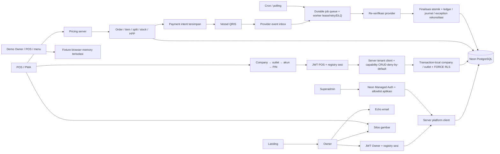

# Peta Sistem Rakku

Tanggal: 17 Oktober 2026. Sumber utama: checkout aktual dan RAKKU_HANDOFF/START_HERE.md beserta referensinya. Branch implementasi: `codex/production-hardening`.

## Arsitektur aktual

Monorepo pnpm/Turborepo berisi empat aplikasi Next.js dan paket domain bersama. Database runtime adalah Neon PostgreSQL melalui Drizzle + postgres.js. Nama folder `supabase` dan sebagian nama variabel merupakan kompatibilitas lama; bukan bukti runtime Supabase aktif.

Sesudah fase 1 lokal, empat aplikasi memakai Next16.4.2/React19.3.1 dan Drizzle0.45.4. Owner/POS memakai `proxy.ts` untuk token/origin/header checks; registry/ownership tetap diperiksa server. Build/test terisolasi tidak memakai resource aktif. Checker environment menolak konfigurasi lokal/production yang masih dibagi; detail serta keterbatasan versi/browser ada di `PHASE_1_REPORT.md`.

| Bagian | Lokasi | Tanggung jawab |
|---|---|---|
| Owner | `apps/owner/src` | Signup, verifikasi, onboarding, tenant management, subscription, saldo, withdrawal, laporan |
| POS | `apps/pos/src` | Company login, outlet/account/PIN, register, draft, pembayaran, inventory, meja, laporan, PWA |
| Superadmin | `apps/superadmin/src` | Managed Auth + allowlist, tenant/plan, saldo/withdrawal, settlement/rekonsiliasi |
| Landing | `apps/landing` | Situs publik dan CTA |
| DB | `packages/db/src`, `packages/db/migrations` | SQL terparameter, transaksi, scope tenant, FORCE RLS, constraint, RPC ledger/stock, grant role/revision/audit |
| RBAC | `packages/auth-utils/src/access-policy.ts`, `apps/pos/src/lib/auth/authorize.ts` | Registry method/path POS, evaluator grant V/C/E/D, deny unknown endpoint |
| Pricing | `packages/pricing/src` | Harga tier/modifier dan quote authoritative; pembulatan nominal |
| Inventory | `packages/inventory/src` | Purchase, adjustment, deduction stock |
| Payments / ledger | `packages/payments/src`, `packages/ledger/src` | Attempt QRIS, verifikasi, finalisasi, saldo atomik/idempoten |
| Subscription / provider jobs | `packages/db/src/subscription-billing.ts`, `jobs.ts`, `provider-events.ts`, `apps/owner/src/lib/billing` | Invoice identity/state, journal/rekonsiliasi, inbox/job, lease/retry/dead-letter, email outbox |
| Settlement / saldo | `packages/ledger/src/settlement.ts`, `apps/superadmin/src/lib/reconciliation.ts`, `config/settlement` | Unsettled→available settlement, exception investigation/resolution, withdrawal hold, opening-balance review |
| Reporting / quota | `packages/shared-types/src/reporting.ts`, `packages/db/src/usage.ts`, report routes | Batas WIB, history cap, HPP snapshot/estimated, email/storage quota counter |
| Operations | `packages/observability`, `packages/db/src/maintenance.ts`, `runtime-flags.ts`, `.github/workflows/ci.yml`, `scripts/ops-*` | Structured log/redaction, health, correlation ID, checkout pause, cleanup, snapshot, restore verify, CI |
| Demo | `packages/demo` | Domain simulasi memory; tidak membuktikan merchant production |

## Alur autentikasi setelah perubahan lokal

Owner: guest → register → email terverifikasi → login password → onboarding bila belum memiliki perusahaan → dashboard. Konfirmasi email tidak mengganti identitas browser secara otomatis. Owner yang sudah memiliki perusahaan diarahkan keluar dari onboarding. Semua halaman login, daftar, cek email, forgot/reset password memakai guard server.

POS: guest → company credential → pending session 10 menit → outlet aktif → akun yang ditugaskan → PIN → sesi kasir 12 jam. Pending token dan sesi penuh memiliki audience berbeda. Pemilihan outlet mengganti dan mengonsumsi pending session sebelumnya. Verifikasi PIN mengonsumsi pending session dan menerbitkan sesi penuh dalam transaksi yang sama. Switch user mencabut sesi penuh dan menerbitkan pending session yang tetap berbatas waktu. Sesi penuh tidak dapat membuka seluruh tahap `/login/*`.

Superadmin: Managed Auth memastikan identitas, lalu allowlist `app_private.superadmins` memastikan hak aplikasi. Login/aktivasi/reset mengarahkan admin yang sudah sah ke panel. API autentikasi menolak penggantian identitas saat sesi aplikasi aktif.

Middleware hanya gerbang awal. Otorisasi authoritative tetap di server dengan pengecekan registry, pemilik, status perusahaan/outlet, role, assignment terbaru dan grant CRUD terkini. Token lama tanpa audience/session ID tidak diterima oleh rilis baru. Endpoint admin/report POS memakai registry method/path; endpoint tidak dikenal ditolak. Mutation grant, role assignment dan status/credential changes mencabut sesi POS terkait dalam transaksi database.

## Alur transaksi

1. **Tunai/manual QRIS/kartu:** identity request → lock company → cari replay → quote katalog server → validasi nominal/split → insert order dan item → insert split → deduksi stock + snapshot HPP → update meja → satu commit. QRIS manual tidak mengkredit ledger provider.
2. **Draft:** simpan order dan item tanpa deduksi. Completion mengunci order, memvalidasi ulang quote, menyimpan split dan stok/HPP dalam satu transaksi. Draft endpoint tidak dapat menghapus order selesai; trigger DB juga menolak penghapusan order dibayar.
3. **QRIS dinamis:** order/item di-commit terlebih dahulu. Invoice/payment intent dicatat sebelum panggilan provider. Respons yang tidak pasti mempertahankan invoice dan mencegah attempt pengganti otomatis. Callback/polling memverifikasi ID, invoice dan jumlah ke provider sebelum finalisasi order + stock + ledger dalam satu commit.
4. **Pembayaran terlambat/ganda:** attempt expired tetap dapat diverifikasi. Bila order masih menunggu, sukses difinalisasi sekali. Bila order sudah selesai/dibatalkan, receipt disimpan sebagai exception rekonsiliasi; tidak menciptakan penjualan kedua atau langsung menambah saldo tersedia.
5. **Inventory:** purchase/adjustment memakai transaction. Deduction mengunci order, produk, resep dan bahan; satu snapshot dipakai untuk jumlah bahan dan HPP. Marker order menutup deduksi ulang termasuk ketika saat penjualan belum ada resep.
6. **Subscription:** checkout menyimpan request/invoice intent sebelum provider; timeout/ambigu mempertahankan invoice sebagai `unknown` dan tidak memakai expiry lokal. Aktivasi success adalah satu transaksi (invoice, company, subscription, journal, job email) dengan guard idempotent. Invoice lama yang dibayar setelah aktivasi lebih baru tidak menurunkan plan; uang masuk `subscription_reconciliation`.
7. **Webhook/provider jobs:** callback Vessel masuk inbox unik, lalu job durable. Worker memakai lease, backoff+jitter, max attempts, dead-letter dan replay terkontrol; verifikasi provider tetap authoritative. Signature HMAC provider aktual, cancel/refund dan lookup-by-invoice belum terbukti.
8. **Settlement/saldo:** receipt QRIS masuk `unsettled_balance`, bukan available. Statement provider yang cocok melepas dana ke available melalui `settlement_credit` per company dalam transaksi; selisih tetap discrepancy. Withdrawal hanya meng-hold available. Exception receipt memiliki status investigate/resolve dengan bukti, tanpa mengedit saldo; refund provider belum tersedia.
9. **Reporting/quota:** laporan memakai batas Asia/Jakarta, HPP snapshot order_item, label estimasi untuk legacy, dan counter quota per company. Email report quota ditegakkan atomik; storage/report-history enforcement masih parsial. Financial request identity tersedia untuk purchase/expense/adjustment/withdrawal bila client mengirim key.
10. **Operations:** health Owner/POS memeriksa DB; proxy meneruskan `x-request-id`; worker/webhook/cron memakai structured log terredaksi. Runtime flag `checkout_paused` menghentikan order/draft completion/QRIS. `ops:snapshot`, `ops:cleanup`, `ops:restore-verify` dan runbook backup/incident tersedia, tetapi CI/restore/alert/step-up dan pilot acceptance belum dijalankan.

## Batas yang perlu dipahami

POS membutuhkan koneksi untuk transaksi merchant. Tidak ada antrean transaksi offline. Cache PWA untuk dokumen, API dan RSC authenticated telah dialihkan ke network-only; aset statis/gambar tetap dapat dicache. Browser history restore dan perubahan identitas lintas tab memicu pemeriksaan ulang sesi. Menu yang terlihat bukan batas keamanan: setiap request admin/report dievaluasi terhadap grant V/C/E/D, page dashboard menolak segmen path tanpa `can_view`, dan grant berubah mencabut sesi role di database. UI POS saat ini belum menyembunyikan semua kontrol berdasarkan grant; server tetap authoritative.

Database dan provider production, custom domain, backup/PITR, restore, cron aktual, device printer dan sesi Managed Auth live belum diuji dalam implementasi lokal ini. Tidak ada migrasi ke database aktif, deploy, atau pembayaran nyata yang dijalankan. Fase 2 RBAC belum diuji pada dua koneksi PostgreSQL atau browser merchant staging; fase 3–4 belum diuji dengan sandbox Vessel, callback nyata, worker multi-instance atau replika job; fase 5–7 belum diuji dengan statement settlement, bank transfer, re-auth, concurrency dua koneksi, storage quota atau reconciliation provider; fase 8–9 belum menjalankan CI GitHub, restore/alert, step-up atau pilot/device/legal acceptance. Keputusan launch saat ini **NO-GO**. Rincian ada di `PHASE_2_REPORT.md`–`PHASE_9_REPORT.md`, `config/provider/README.md`, `config/settlement/README.md`, `config/operations/README.md` dan `config/pilot/README.md`.
